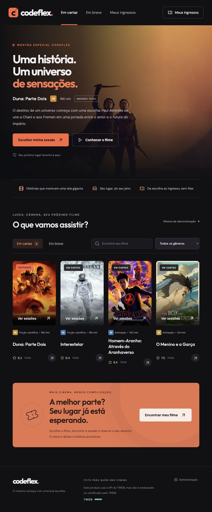
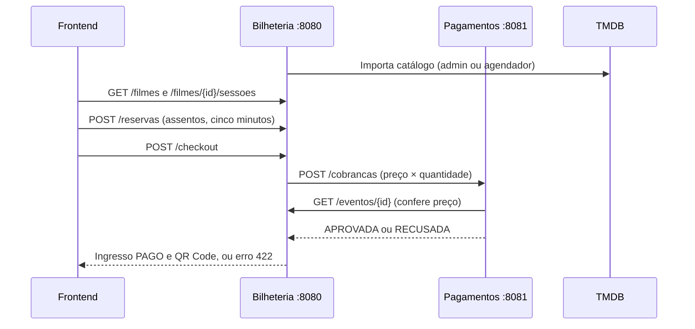

# Codeflex Cinema

Bilheteria, pagamentos e uma experiência de cinema em um único repositório. Catálogo com cartazes, sessões por data, seleção de assentos, reserva de cinco minutos, checkout simulado e ingresso com QR Code. O painel administrativo gerencia salas, sessões, importação TMDB e relatórios.



## Estrutura

```text
frontend/     React 19 + Vite · porta 5173
bilheteria/   Spring Boot + PostgreSQL · porta 8080
pagamentos/   Spring Boot + PostgreSQL · porta 8081
scripts/      Inicialização local e teste integrado
postgres/     Inicialização dos bancos do Docker
.run/         Configurações compartilhadas do IntelliJ
```



Os serviços mantêm bancos separados: `codeflex_bilheteria` e `codeflex_pagamentos`. A sessão estende o modelo `Evento` do contrato, preservando `/eventos/{id}` e `/eventos/{id}/comprar`. Não há acesso direto de um serviço ao banco do outro.

## Executar com Docker

```bash
cp .env.example .env
# Edite .env e defina ADMIN_TOKEN com uma chave longa e aleatória.
docker compose up --build
```

Acesse [http://localhost:5173](http://localhost:5173). Os dois bancos são criados automaticamente na primeira inicialização do volume. O PostgreSQL do Compose fica disponível localmente na porta 5433. `docker compose down` preserva o volume e os dados.

## Executar localmente

Requisitos: Java 21 ou superior, Node 22.12+ e PostgreSQL. Maven Wrapper incluído.

Crie os bancos no pgAdmin/psql:

```sql
CREATE DATABASE codeflex_bilheteria;
CREATE DATABASE codeflex_pagamentos;
```

```bash
cp .env.example .env
# Ajuste o usuário/senha locais e ADMIN_TOKEN em .env.
npm ci --prefix frontend
./scripts/dev.sh
```

O script compila os serviços, inicia as três aplicações e grava os logs em `.runtime/`. Ctrl+C encerra os processos iniciados por ele. Não execute duas instâncias nas mesmas portas.

- Interface: [localhost:5173](http://localhost:5173)
- Swagger Bilheteria: [localhost:8080/docs](http://localhost:8080/docs)
- Swagger Pagamentos: [localhost:8081/docs](http://localhost:8081/docs)

### IntelliJ

Abra o `pom.xml` da raiz como projeto Maven e selecione JDK 21+. As configurações **Codeflex - Bilheteria** e **Codeflex - Pagamentos** estão em `.run/`.

No Run Configuration da Bilheteria, adicione `ADMIN_TOKEN` e, se disponível, `TMDB_API_TOKEN`. O IntelliJ não carrega `.env` automaticamente; copie as variáveis em **Run → Edit Configurations → Environment variables**. Execute os dois serviços e, no terminal, `npm run dev --prefix frontend`.

As credenciais PostgreSQL padrão são de desenvolvimento (`postgres` / `admin`). As variáveis `DATABASE_USER`, `DATABASE_PASSWORD` e `DATABASE_URL` substituem os padrões. Ao iniciar os serviços separadamente, use uma `DATABASE_URL` diferente para cada um.

## TMDB e cartazes

Configure **uma** das variáveis no servidor da Bilheteria:

```dotenv
TMDB_API_TOKEN=seu_api_read_access_token
# Alternativamente:
TMDB_API_KEY=sua_chave_v3
```

O token Bearer é preferido; a chave v3 também é aceita. Nenhuma credencial é enviada ao frontend. Não coloque essas variáveis com prefixo `VITE_`.

1. Abra **Administração** e informe o mesmo `ADMIN_TOKEN` do servidor.
2. Clique em **Atualizar em cartaz / em breve**.
3. O serviço importa a primeira página de `/movie/now_playing` e `/movie/upcoming` para a região BR e idioma pt-BR, com detalhes, gêneros, duração, certificação brasileira, elenco e trailer quando disponíveis.
4. Programe sessões nas salas cadastradas. O TMDB não fornece a programação do seu cinema.

A busca administrativa permite importar um filme pelo título. O catálogo fica persistido no PostgreSQL e a navegação não consulta o TMDB a cada visita. A atualização diária executa às **03:00, America/Sao_Paulo**. Erros de rede ou 429 interrompem a atualização sem apagar os filmes já armazenados; o próximo ciclo tenta novamente. A importação usa `tmdb_id` único e intervalo entre requisições. A sincronização manual é protegida contra execução concorrente nesta instância.

Sem chave, `DEMO_MODE=true` popula uma **mostra de demonstração**, identificada na interface, com cartazes de filmes conhecidos e sessões locais para os próximos cinco dias. Esses filmes **não representam a lista atual de lançamentos**. A carga acontece somente em banco sem filmes; reiniciar não duplica nem renova sessões. Para catálogo real sem demonstração, comece com banco vazio e `DEMO_MODE=false`, importe os filmes e cadastre sessões.

Os cartazes são carregados do CDN público do TMDB; falhas exibem um cartão com o título. O QR Code é gerado localmente no navegador. Os filmes da mostra são exemplos, não recomendações de programação atual.

Fontes: [autenticação](https://developer.themoviedb.org/docs/authentication-application), [em cartaz](https://developer.themoviedb.org/reference/movie-now-playing-list), [imagens](https://developer.themoviedb.org/docs/image-basics), [certificações](https://developer.themoviedb.org/reference/movie-release-dates).

Este produto usa a API do TMDB, mas não é endossado ou certificado pelo TMDB.

## Compra e critérios dos PDFs

- `POST /eventos/{id}/comprar`: CPF com 11 dígitos, quantidade positiva e `cartao_final` com quatro dígitos.
- Vagas insuficientes: **422**, sem chamar Pagamentos.
- Pagamentos consulta `GET /eventos/{id}` e compara `preco × quantidade` usando `BigDecimal.compareTo`.
- Evento inexistente na Bilheteria: Pagamentos responde **422 `regra_negocio`**.
- Valor divergente: **422 `valor_divergente`**.
- Cartão `0000`: cobrança **RECUSADA**; Bilheteria retorna **422**, não cria ingresso e não baixa vagas.
- Outros finais válidos: cobrança **APROVADA**, ingresso **PAGO**, vagas reduzidas pela quantidade.
- `GET /cobrancas/{id}`: cobrança ou **404 `nao_encontrado`**.
- JSON em `snake_case`, DTOs de entrada em record e erros `{codigo,mensagem,detalhes}`. Dados inválidos usam o 400 padrão do Spring.

### Assentos e reserva

A planta é gerada pelas fileiras/colunas da sala. `POST /reservas` mantém os lugares por cinco minutos. Reservas vencidas deixam de bloquear os assentos na próxima consulta, sem precisar de um processo de exclusão. `DELETE /reservas/{token}` libera antecipadamente.

A reserva e a compra usam bloqueio pessimista no evento, e os assentos vendidos têm unicidade `(evento_id, assento)` no banco. O checkout do mesmo token retorna o ingresso já emitido, sem nova cobrança. A chamada interna leva `Idempotency-Key`; Pagamentos reaproveita uma cobrança aprovada para a mesma chave e os mesmos dados. A recusa não consome essa chave, permitindo outra tentativa enquanto a reserva estiver válida.

O mapa permite até oito lugares por reserva. O preço é o inteiro por sessão; meia-entrada não foi adicionada porque exige ampliar o contrato de conferência de valor. O total é calculado no backend.

Sessões na mesma sala não podem se sobrepor, incluindo vinte minutos de intervalo. Sessões com ingressos vendidos ou reservas ativas não podem ser alteradas/removidas. O QR Code contém um token aleatório para consulta; CPF não é exposto na consulta pública do ingresso. “Meus ingressos” guarda apenas esses tokens no navegador, sem cadastro de conta.

### Painel

A chave administrativa fica apenas em memória no frontend. `/admin/**` exige `X-Admin-Token`. É possível criar, editar e desativar salas/sessões, importar filmes e consultar ocupação, faturamento por dia e vendas por filme. Salas com sessões cadastradas não permitem alterar a planta.

## Validação

```bash
./mvnw test
npm run build --prefix frontend
# Com os dois serviços ligados, cria um evento de teste e compras simuladas:
python3 scripts/smoke.py
```

Os testes usam H2 isolado e servidores HTTP simulados, sem credenciais TMDB nem PostgreSQL local. Cobrem contrato, validações, concorrência de reservas, expiração, idempotência, recusa, estoque, sobreposição de sessões, acesso administrativo e importação TMDB/429. O script smoke verifica a comunicação HTTP real dos dois serviços e preserva o evento de teste para inspeção. GitHub Actions executa o backend e o build do frontend.

Também foi validada no navegador uma compra com seleção de assentos, confirmação e QR Code, com os dois serviços e PostgreSQL reais.

## Escopo e evolução

Aplicação acadêmica com **pagamento simulado**, baseada nas rodadas 1 e 2. Os campos de webhook do contrato estão preservados, mas processamento assíncrono e entrega de webhook da rodada 3 não fazem parte desta versão. A carta de evento adicional não foi fornecida.

A autenticação administrativa é por chave única de desenvolvimento; para operação pública, é necessário evoluir para contas/perfis e proteger também o endpoint acadêmico `POST /eventos`. O sistema não processa cartão completo nem pagamento bancário. Para um gateway real, seriam necessários reconciliação e reembolso para falhas entre a cobrança remota e a transação local. O QR Code consulta o ingresso; ainda não faz controle de entrada/check-in.

As sugestões opcionais de Telegram, séries, cupons, combos, fidelidade, avaliações e recomendações não integram o fluxo de venda desta versão. Redis não é necessário para a reserva implementada com PostgreSQL. Classificação indicativa é informativa, sem coleta de idade.

## Origem

- Pagamentos: [augusto1507/codeplax-pgamentos-api](https://github.com/augusto1507/codeplax-pgamentos-api), base `72bfa74`, acrescida das alterações locais da rodada 2.
- Bilheteria: [LeticiaCardos0/codeplex-bilheterias-api](https://github.com/LeticiaCardos0/codeplex-bilheterias-api), base `95f445d`. A implementação foi reorganizada e os trechos incompletos corrigidos para realizar o fluxo do contrato.
- Requisitos: PDFs “Abertura e contrato” e “Rodada 2 — Consome”, e sugestões de integração TMDB fornecidas pelo usuário. Os documentos originais e credenciais não são publicados neste repositório.
